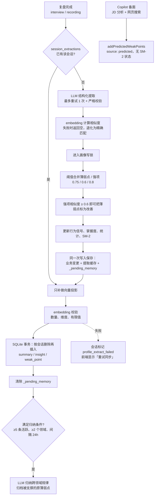
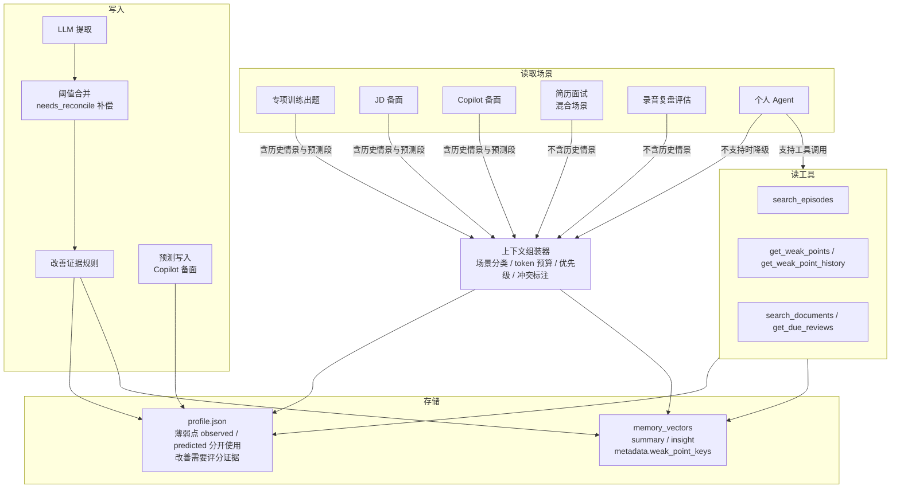

# TechSpar 记忆模块整改方案（RFC）

| 项 | 内容 |
|---|---|
| 文档状态 | 草案，待与维护者对齐 |
| 代码基线 | `main` 分支，commit `1fdfe71`（记忆相关文件与 `e7fe41e` 相同） |
| 适用范围 | 用户画像、向量记忆、上下文组装、个人 Agent |
| 编写日期 | 2026-11-24 |

## 目录

- [第一部分：整改计划方案](#第一部分整改计划方案)
  - [1. 背景与目标](#1-背景与目标)
  - [2. 现状问题清单](#2-现状问题清单)
  - [3. 推进原则与总体路线](#3-推进原则与总体路线)
  - [4. 验证策略](#4-验证策略)
  - [5. 阶段一：无争议修复](#5-阶段一无争议修复)
  - [6. 阶段二：写入可信度](#6-阶段二写入可信度)
  - [7. 阶段三：上下文组装与冲突标注](#7-阶段三上下文组装与冲突标注)
  - [8. 阶段四：个人 Agent 工具化](#8-阶段四个人-agent-工具化)
  - [9. 后续可选项](#9-后续可选项)
  - [10. 数据与兼容性](#10-数据与兼容性)
  - [11. PR 拆分与时间](#11-pr-拆分与时间)
  - [12. 风险与应对](#12-风险与应对)
  - [13. 评审与合并流程](#13-评审与合并流程)
- [第二部分：当前架构](#第二部分当前架构)
- [第三部分：目标架构与差异对比](#第三部分目标架构与差异对比)

---

# 第一部分：整改计划方案

## 1. 背景与目标

### 1.1 背景

TechSpar 的记忆系统是一条**复盘后执行的流水线**：每次面试复盘结束，LLM 从会话中提取结构化信息，用相似度阈值合并进 `profile.json`；下次出题或评估时，再把画像拼成文本注入提示词。

写入侧的可靠性设计相当扎实：画像是主数据，向量是可重建的投影，写入分两阶段、可重试且不重复计数（见 `docs/memory-reliability-design.md`、`docs/memory-index-rebuild-design.md`）。本方案保留这些设计，问题集中在：

- **写入可信度**：一个薄弱点可以在没有评分证据的情况下被标为已改善；根据 JD 和网页搜索推出的“预测薄弱点”被当成已知事实使用。
- **读取**：历史会话的语义记忆只在专项训练出题时使用；个人 Agent 注入完整画像 JSON，关键内容可能被截掉。
- **Agent 能力**：个人 Agent 只调用一次 LLM，不能主动查询记忆。

### 1.2 目标

1. **记下来的东西可信**：状态变化需要证据，预测与事实分开，失败可以补偿。
2. **该用的地方用上**：出题和准备类场景能检索历史记忆；评分场景不受历史记忆影响；新旧记忆冲突时显式标注。
3. **Agent 能主动用**：个人 Agent 通过工具按需检索记忆，模型不支持工具调用时自动降级。

### 1.3 非目标

- 不建离线质量评测集，不声称“记忆质量提升了多少”。
- 不在主线中修改画像数据模型的结构（不做 schema 迁移）。
- 不引入外部向量数据库或图数据库（Electron 桌面端需要本地部署）。
- 不用 mem0、Letta 等通用框架替换现有实现。
- 不涉及多进程、多实例部署下的画像存储改造。

## 2. 现状问题清单

### 2.1 已确认的问题

| 编号 | 问题 | 位置 | 影响 | 优先级 |
|---|---|---|---|---|
| P-1 | 历史会话的语义记忆只在专项训练出题时使用（唯一传入 topic 的调用是 `interview-service.ts:306`）。JD 备面、简历面试、录音复盘、Copilot 备面都调用不带 topic 的 `summary(userId)`，拿不到历史情景 | `interview-service.ts:203,278`；`resume-state-machine.ts:70`；`recording-service.ts:150,160`；`copilot/prep-service.ts:197` | 准备类场景缺少历史上下文 | 中 |
| P-2 | 个人 Agent 把 `profile.get()` 返回的整个画像 JSON 截断到 14000 字注入提示词。在 `get()` 返回的字段顺序中，`topic_mastery` 排在 `weak_points` 前面，有 retrospective 全文时会把薄弱点挤出截断范围；`session_extractions` 排在 `stats` 之后，通常自己先被截掉，但同样占用了无用空间 | `personal-agent-service.ts:81`；`profile-service.ts:239,493` | 薄弱点可能丢失，token 浪费 | 高 |
| P-3 | 个人 Agent 只做一次 LLM 调用，没有工具；驱动层不支持工具调用 | `personal-agent-service.ts:82`；`provider/ports.ts:100` | 无法按需查询记忆 | 中 |
| P-4 | `weak_point` 向量有三个写入点，全仓库没有读取方 | `profile-service.ts:182,661`；`settings-operations.ts:126` | 浪费 embedding 调用、拉长事务 | 高（简单） |
| P-5 | 写入时 embedding 失败，薄弱点和强项的去重都只剩精确文本匹配，产生同义重复；`vectorsFor` 吞掉异常后返回空结果，调用方无法识别失败。现有“重试同步”只补做向量投影，**不会合并已写入画像的重复条目**；如果 embedding 只是短暂失败、随后的投影成功，会话不会被标记失败，重复条目也不会被发现 | `profile-service.ts:405,669-671,705` | 画像中出现无法修复的重复 | 中 |
| P-6 | 改善状态缺少评分证据：LLM 提取出的强项只要与某个薄弱点相似度 ≥ 0.6，就能把它标为已改善，不要求任何评分 | `profile-service.ts:735-736` | 薄弱点可能被错误地“改善”掉 | 高 |
| P-7 | 规律被用户判定为不准确时，被它归档的原薄弱点不会恢复。另外，规律归纳只跳过同名且未归档的规律（`:645`），被否定的规律在冷却期过后可能被重新归纳出来 | `profile-service.ts:577,645` | 薄弱点永久丢失；被否定的结论反复出现 | 高（简单） |
| P-8 | Copilot 备面根据 JD 文本和网页搜索结果推出的“预测薄弱点”（`source: predicted`）直接写入画像，topic 是岗位名而不是知识领域。`summary()` 把它们和观察到的薄弱点一起列为“已知知识薄弱点”；预测条目没有 SM-2 状态，`dueReviews()` 会立刻把它们列为“到期复习”；没有过期机制；在没有 topic 的会话（JD 备面、录音复盘）中被高分答对时，会被标为“已改善”而不是被证伪 | `copilot/prep-service.ts:228`；`profile-service.ts:506,521,586,720,728` | 未经证实的推测被当作事实使用；外部内容可以影响画像 | 中 |
| P-9 | 评分场景注入了画像：录音复盘的评估提示词包含画像摘要；简历面试的面试官提示词同时负责提问和内部评估，也注入了画像 | `recording-service.ts:150,160`；`interview/prompts.ts:1-35`；`resume-state-machine.ts:70` | 评分可能先入为主；如果再加入历史情景，影响会更大 | 中 |
| P-10 | 个人 Agent 的跨对话记忆是“其他对话最近 12 条原文” | `personal-agent-repository.ts:112` | 无检索、无摘要 | 低 |
| P-11 | `weak_points`、`history`、`score_history` 无限增长，retrospective 全文存在画像里 | `profile-service.ts:613` | 文件膨胀 | 低 |

### 2.2 待验证的假设

| 编号 | 假设 | 为什么还不能当作问题 | 验证方式 |
|---|---|---|---|
| H-1 | 已掌握的知识点会被反复考察 | `summary()` 和到期复习都已排除已改善的条目；历史情景只在专项训练中出现，最多 3 条，且提示词已说明“以当前状态为准” | 用自己的账号练习，记录已改善知识点是否再次出现在题目中；能复现才列为问题，并据此决定冲突标注之外是否还要降权 |

## 3. 推进原则与总体路线

### 3.1 原则

| 原则 | 含义 |
|---|---|
| 修复与设计分开推进 | 无争议的修复先独立提交和合并；需要决策的设计基于本文档讨论，讨论不阻塞修复 |
| 描述具体 | 设计说明和 PR 描述以具体问题、代码位置和机制为准 |
| 不改数据结构 | 主线只用现有字段和派生值；新增字段只有用户事实（随 `remember` 工具一起引入） |
| 可验证 | 每项改动都用确定性场景测试或客观指标验收 |
| 可降级、可开关 | 任何一环失败都退回现有行为；新行为都可以单独关闭 |
| 证据优先 | 状态变化必须有证据；推测和事实分开 |

### 3.2 总体路线

| 阶段 | 内容 | 合并前需要的讨论 |
|---|---|---|
| 阶段一 | P-4、P-2、P-7 三项无争议修复 | 无，按常规 PR 评审 |
| 阶段二 | 写入可信度：改善需要评分证据（P-6）、预测薄弱点隔离（P-8）、embedding 失败补偿（P-5） | P-6、P-8 先在 issue 中确认规则和阈值；每个 PR 附设计说明 |
| 阶段三 | 上下文组装器、场景分类（P-1、P-9）、冲突标注 | 基于本文档确认设计 |
| 阶段四 | 驱动层工具调用、个人 Agent 读工具与降级（P-3） | 基于本文档确认设计 |
| 后续 | 可观测与界面、`remember` 写工具、对话摘要、遗忘压缩等 | 视讨论结果决定是否进行 |

## 4. 验证策略

本方案不建离线评测集，用三种不需要标注的手段验证：

| 手段 | 回答的问题 |
|---|---|
| 确定性场景测试 | 关键情形下的行为是否符合设计 |
| 客观运行指标 | 成本、延迟等可直接计算的量是否改善 |
| 实际使用案例 | 实际使用中有没有肉眼可见的差别；验证 H-1 |

**边界**：这些手段能证明“行为正确”和“成本变化”，不能证明“记忆质量提升了多少”。

### 4.1 确定性场景测试

写法沿用 `tests-ts/profile-memory-retry.test.ts`：临时目录、真实 SQLite、可控的 LLM 和 embedding 替身。测试只验证**确定性规则**，不测试“模型是否会听从注入”这类替身模型必然通过的情形。

| 编号 | 场景 | 期望 |
|---|---|---|
| S-1 | 一次复盘写入向量记忆 | 不再写入 `weak_point` 类型的向量；该次 `embed` 调用的输入条数减少（调用次数不变） |
| S-2 | 画像含 100 条提取缓存和长篇 retrospective，发起 Agent 对话 | 提示词不含提取缓存和 retrospective 全文；前 5 个活跃薄弱点都在 |
| S-3 | 规律 R 归档了薄弱点 A、B，用户判定 R 不准确 | A、B 恢复为活跃；同时被其他有效规律覆盖的不恢复；已被新观察解除归档的不受影响 |
| S-3b | R 被否定后，冷却期结束再次触发规律归纳 | 不再生成与 R 同文本、或支撑集合相同的规律 |
| S-4 | 有逐题评分的会话中，提取出的强项与薄弱点 X 相似 | X 的状态不变，只追加一条正向证据；只有命中的题目评分 ≥ 8 时才改善 |
| S-5 | 没有逐题评分的会话（简历面试）中，强项与 X 相似 | 按 §6.1 的规则：自上次负向事件以来，两次不同会话都有正向证据时才改善；中间出现负向事件则重新计数 |
| S-6 | Copilot 备面写入预测薄弱点 | 不出现在到期复习中；出题上下文中单独成段并注明“未证实”；评分上下文中不出现 |
| S-7 | 先做 Copilot 备面产生预测，再做 JD 备面，预测条目被提取出的薄弱点命中 | `source` 转为 `observed`，topic 改为提取结果中的领域，开始参与 SM-2 |
| S-7b | 同上流程，JD 备面中命中预测条目的题目评分 ≥ 8；另测录音复盘同样情形 | 归档，原因为 `predicted_disproved`，不标为“已改善” |
| S-7c | 预测条目自 `last_seen` 起超过有效期；以及同一预测再次出现后续期 | 过期的在下次写入时归档、在读取时被过滤；续期的不归档 |
| S-8 | 写入时 embedding 抛异常，或只返回部分向量 | 新建的薄弱点和强项带标记；即使向量投影成功，会话也被标记为需要重试；重试后同义条目合并为一条，主条目的 SM-2 进度保留并重放了较新的评分 |
| S-8d | embedding 恢复后，又有两次正常复盘命中了重复条目，之后才重试 | 两次较新的评分都按日期顺序在主条目上重放 |
| S-8e | 主条目是先写入的 `predicted`，被并入的是 embedding 失败时新建的 `observed` | 合并结果为 `observed`，topic 为知识领域 |
| S-8b | 重试时 embedding 再次失败 | 标记保留，会话仍为需要重试 |
| S-8c | 会话 A、B 都留下带标记的条目，只重试 B | A、B 的条目都被合并；A 的失败标记也被清除 |
| S-9 | 历史情景关联薄弱点 X，X 当前已改善 | 组装后的情景附带“X 已于某日改善”标注 |
| S-9b | 同一个键对应多条薄弱点（例如归档导入后的“Redis AOF”与“RedisAOF”），包括 `last_seen`、`first_seen` 都相同、数组顺序不同的情况 | 按 §7.3 的冲突规则取一条；打乱数组顺序后结果不变 |
| S-10 | 没有关联信息的旧情景 | 用文本匹配兜底标注 |
| S-11 | 录音复盘评估、简历面试 | 上下文中不含历史情景段 |
| S-12 | 记忆总量远超预算 | 按优先级从低到高截断；到期复习和活跃薄弱点始终保留 |
| S-13 | 替身模型先调用 `search_episodes` 再回答 | 工具被执行、结果回填、回答保存工具轨迹 |
| S-14 | 模型标记为不支持工具调用；或连续两次返回格式错误的调用 | 自动退回静态注入，对话正常完成 |

### 4.2 客观运行指标

| 指标 | 来源 | 说明 |
|---|---|---|
| 每次复盘的 embedding 输入条数 / token 数 | 写入路径计数 | 验证 P-4。会话记忆在一次 `embed` 调用中批量计算（`profile-service.ts:467`），删除 weak_point 减少的是输入条数，不是调用次数；只有规律归纳后的写入和索引重建步骤会少掉整次调用 |
| 个人 Agent 首轮提示词 token | `ChatResult.promptTokens` 的真实值 | 验证 P-2；需要把真实 token 从驱动层传到业务层（见 §7.4） |
| 个人 Agent 首字延迟与总延迟 | 计时 | 工具调用会增加轮次，必须监控 |
| 工具调用降级率 | 按模型统计 | 判断哪些模型适合开启工具调用 |
| 上下文截断率 | 组装器输出 | 用于调整预算 |
| 冲突标注次数 | 组装器输出 | 观察 H-1 相关情形的实际频率 |
| 组装延迟 | 记忆为 100 / 1k / 10k 行时的 p95 | 规模预警 |

“覆盖了多少个场景”只是覆盖率，不作为验收标准。

### 4.3 实际使用案例

- 用同一个账号在改动前后各完成若干次训练，整理 5–10 个典型案例，写进 PR 描述。
- 专门记录 H-1：已改善的知识点是否再次被考察。
- 只放脱敏片段和截图，不提交原始训练记录。

## 5. 阶段一：无争议修复

这三项不涉及设计取舍，可以独立评审和合并，不依赖后续阶段的讨论。

### 5.1 删除 `weak_point` 向量的无效写入（P-4）

- 删除 `sessionMemory` 中的 `weak_point` 条目（`profile-service.ts:182`）、规律归纳后的 `appendMemories`（`:661`）、索引重建中的 `weak_points` 步骤（`settings-operations.ts:126`）。
**无论怎样处理重建步骤，都要修改的地方：**

| 位置 | 原断言 | 修改 |
|---|---|---|
| `tests-ts/profile-memory-retry.test.ts:85,107,110,130,237,251` | 记忆条数为 3（第三条是 weak_point） | 改为 2 |
| `tests-ts/profile.test.ts:177` | 记忆类型包含 `weak_point` | 去掉 `weak_point` |
| `tests-ts/profile.test.ts:201` | 规律归纳后能查到 weak_point 向量（对应 `:661` 的写入） | 改为断言规律已写入画像，且没有写入向量 |
| `tests-ts/contracts/phase-four-profile.test.ts:87,98,156` | 记忆条数为 3 | 改为 2 |
| `tests-ts/settings-provider.test.ts:221` | 重建时调用了 `vectors:weak_point` | 改为 `not.toContain('vectors:weak_point')` |
| `tests-ts/contracts/service-response-boundaries.test.ts:134-136` | 重建时写入了 `user-a:weak_point` 分块 | 改为断言没有写入该分块 |
| `docs/memory-reliability-design.md` | 验收表中的“3 条”及说明 | 改为 2 条 |

`tests-ts/knowledge-retrieval.test.ts:127` 直接调用向量仓库的 `replaceChunks` 写入 weak_point 类型，测试的是仓库本身，不受影响。

**随之失去调用方的代码**：删除 `:661` 后，私有方法 `appendMemories`（`profile-service.ts:453-462`）不再有调用方，一并删除。它调用的端口方法 `appendProfileMemories`（`ports.ts:28`、`knowledge-vector-repository.ts:122`）在 PR-1 中保留，避免扩大改动范围；是否移除留给后续清理。

**重建步骤与契约字段，二选一：**

| 方案 | 做法 | 额外影响 |
|---|---|---|
| A（推荐，PR-1 采用） | 保留重建步骤和 `rebuilt.weak_points` 字段，作为**为兼容保留的占位步骤**：不做任何操作，直接标记成功。不需要在这一步清理数据：重建的第一步 `cleanup` 调用 `invalidateUserVectors`，已经删除了该用户除 `session_summary` / `insight` 以外的全部向量行（`knowledge-vector-repository.ts:164`），包括 weak_point；`cleanup` 失败时整个重建会中止（`settings-operations.ts:135`），轮到这一步时已无数据可清 | 契约、fixture、步骤总数（`total: 4`）都不变；`settings-provider.test.ts:219`、`memory-index-rebuild.test.ts:110`、`contracts/phase-three-sse.test.ts:159` 断言的 `weak_points: true` 仍然成立 |
| B | 删除重建步骤，从契约中移除字段 | 契约使用 `.strict()`（`index-rebuild-events.ts:11`），属于破坏性变更。需要修改上面 3 处断言、`contracts/phase-three-events.test.ts:64`、`phase-three-frontend.test.ts:90`、`phase-three-sse.test.ts:32` 的 fixture，以及 `memory-index-rebuild.test.ts:109` 断言的步骤总数 `total: 4`，再运行 `bun run gen:api`。前端源码没有读取这个字段（只出现在生成的 `schema.d.ts` 中），界面不受影响 |

方案 B 可以在与维护者确认后，作为单独的清理 PR。

- **数据库中已有的 weak_point 行**：不需要专门清理。重建时由 `cleanup` 步骤（`invalidateUserVectors`）删除；会话重新投影时，`replaceSessionMemories` 删除该会话的旧行。它们没有读取方，在被删除之前也不影响行为。
- 验收：S-1；上表所列断言和文档按说明更新，其余测试不变且全部通过。

### 5.2 个人 Agent 上下文精简（P-2）

- 新增一个精简的画像视图，只包含：前若干个活跃薄弱点、跨会话规律、强项、负向行为信号、各领域掌握度分数（不含 retrospective 全文）、统计概要。
- 剔除 `session_extractions`、`history`、retrospective 全文、内部字段。
- 验收：S-2；首轮提示词 token 的真实值下降。

### 5.3 规律撤销恢复（P-7）

- 用户判定规律不准确、规律被归档时，按规律的 `consolidates` 文本，精确匹配被它归档的原薄弱点。
- **只恢复仍处于归档状态、且 `archived_reason = superseded_by_consolidation` 的条目**。已经被新观察解除归档的条目（`profile-service.ts:709`）不要动。
- 如果某个原薄弱点同时被另一条仍有效的规律覆盖，则不恢复。
- **防止被否定的规律反复出现**：规律归纳时，跳过与已被否定的规律（`archived_reason = user_refuted`）文本相同、或支撑集合（`consolidates`）相同的结果。被否定的规律本身仍保留在 `weak_points` 中，不需要新增字段。
- 验收：S-3、S-3b。

## 6. 阶段二：写入可信度

### 6.1 改善需要评分证据（P-6）

> 这一项改变的是“进步何时被承认”，是产品争议最大的一项。先开 issue 讨论规则和阈值，达成一致后再提 PR。

按会话是否有逐题评分区分：

| 会话类型 | 现在 | 改为 |
|---|---|---|
| 有逐题评分（专项训练、JD 备面、录音复盘） | 强项与薄弱点相似度 ≥ 0.6 即标为改善 | 强项只追加一条 `positive_evidence` 历史事件，不改变状态；改善只由命中的题目评分 ≥ 8 触发（沿用现有逻辑） |
| 没有逐题评分（简历面试的复盘不保存逐题评分，见 `interview-service.ts:444`） | 同上 | 单次只记证据；满足下面的计数规则时才标为改善 |

**计数规则（无评分会话）：**

| 问题 | 规定 |
|---|---|
| 什么算一次正向证据 | 来自任意会话的 `positive_evidence` 事件（包括有评分会话中强项匹配产生的），每个会话最多计一次 |
| 需要几次 | 来自 2 个不同会话（阈值待维护者确认） |
| 从什么时候开始计数 | 从最近一次负向事件之后开始。负向事件包括：再次被提取为薄弱点、命中的题目评分 < 5、状态回退（`regressed`） |
| 中间出现负向事件怎么办 | 计数清零 |

**关于“评分证据”的准确表述**：题目评分要通过题目的 `weak_point`、`focus_area` 或题干文本与薄弱点的相似度 ≥ 0.6 才能挂到薄弱点上（`profile-service.ts:721`）。它比 LLM 总结出的强项描述更可信，但也不是直接证据。

- 不能简单规定“只认逐题评分 ≥ 8”，否则简历面试将永远无法标记改善。
- 简历面试的过程评估（`eval_history`）带有分数，未来可以作为证据来源，但映射到具体薄弱点需要额外设计，先不做。
- 验收：S-4、S-5。

### 6.2 预测薄弱点隔离（P-8）

> 这一项涉及画像页如何展示预测条目，建议先开 issue 与维护者对齐展示方式。

**读取**

- `dueReviews()` 排除 `source: predicted` 的条目。
- 出题和准备类场景：预测条目单独成段，标题为“根据目标岗位预测、尚未在训练中证实的考察点”，不再混入“已知知识薄弱点”。
- 评分场景：不注入预测条目。

**状态流转**

预测条目的 topic 是岗位名（`copilot/prep-service.ts:228`：`topic: prep.position || '综合'`），不是知识领域。各类会话能否命中预测条目：

| 会话 | 是否有 topic | 逐题评分匹配（`:720`） | 提取出的薄弱点匹配（`:704`） | 强项匹配（`:734`） |
|---|---|---|---|---|
| **JD 备面**（主要路径：先从 JD 预测，再做 JD 练习） | 无（写库时不带 topic，`interview-repositories.ts:174`） | 不按领域过滤，可以命中 | 可以命中 | 按强项自身的 topic 过滤，强项的 topic 是知识领域，几乎不会等于岗位名 |
| 录音复盘 | 无 | 可以命中 | 可以命中 | 同上 |
| 专项训练 | 有 | 按领域过滤，不会命中 | 可以命中 | 同上 |

状态流转：

| 事件 | 现在 | 改为 |
|---|---|---|
| 被提取出的薄弱点命中（证实） | 留在 `predicted`、岗位名 topic 下 | `source` 改为 `observed`，topic 改为提取结果中的领域，开始参与 SM-2 |
| 被高分题目（≥ 8）命中（证伪） | 标为“已改善” | 归档，原因为 `predicted_disproved` |
| 被强项命中 | 理论上会标为“已改善”，实际几乎不会发生 | 不作为证伪路径；万一命中，只记一条正向证据 |
| 长期未被证实（过期） | 永久保留 | 自 `last_seen` 起超过有效期（建议 30 天，待确认）后归档，原因为 `predicted_expired` |

**过期的触发时机**：系统没有定时任务，采用两处处理：

- **写入时归档**：在 `afterReview` 和 `addPredictedWeakPoints` 的画像写锁内，把已过期的预测条目归档。
- **读取时过滤**：`summary()` 和 `dueReviews()` 跳过已过期但尚未归档的条目，保证长期不训练的用户也看不到过期预测。
- **从 `last_seen` 起算**：同一条预测再次出现时，`addPredictedWeakPoints` 会刷新 `last_seen`（`profile-service.ts:512`），相当于续期。

- 验收：S-6、S-7、S-7b、S-7c。

### 6.3 embedding 失败补偿（P-5）

**范围**：薄弱点（阈值 0.75 / 0.6）和强项（阈值 0.8）都在范围内。embedding 失败时两者都会退化为精确匹配。

**识别失败**

- 现在的 `vectorsFor` 捕获异常后返回空 Map（`profile-service.ts:405-412`），只返回部分向量时也会静默跳过（`:410`），调用方无法区分“失败”和“没有需要计算的文本”。
- 改为返回 `{ vectors, failed }`：调用抛异常，或返回的向量数少于输入文本数时，`failed` 为真。现有的其他调用方可以忽略这个标志，行为不变。

**标记与触发**

- `failed` 为真时，本次新建的薄弱点和强项都打上标记：`needs_reconcile: [sessionId]`，记录是哪次会话产生的。
- 现在会话被标记失败只有一个途径：`afterReview` 抛异常，由调用方捕获后写 `profile_extract_failed`（`interview-service.ts:413-421`、`recording-service.ts:183-190`）；重试入口根据这个标记判断（`interview-service.ts:403`）。
- 为了在“投影成功但仍需补偿”时也能触发重试：`afterReview` 的返回值增加一个 `needsRetry` 标志，两个调用方在标志为真时写 `profile_extract_failed: true`。重试入口的判断不变。

**补偿时机与粒度**

- 补偿挂在现有的“重试同步”路径上：`afterReview` 命中提取缓存的分支中、调用 `projectSessionMemory` 之前执行。不另起后台任务。
- 补偿按**用户**执行：任意一次重试都会处理该用户全部带标记的条目，包括其他会话遗留的。
- **补偿成功后，清除标记中记录的所有会话的失败标记**（通过 `deps.sessions.updateMeta`），避免会话 A 的条目已在会话 B 的重试中处理完，A 的“重试同步”按钮却还在、点了也不做任何事。前提是这些会话的向量投影本身已经成功（`_pending_memory` 中没有它们的快照）；仍有待写快照的会话保留失败标记。
- **重试时 embedding 再次失败**：保留所有标记，再次返回 `needsRetry`。

**合并规则**

合并的本质是：把“当初应该命中已有条目、却因为 embedding 失败而新建”的观察，按命中时的逻辑在主条目上重放。

**候选范围**：与 `afterReview` 的合并循环使用相同的过滤条件（`profile-service.ts:704`），排除 `source: consolidated` 和 `axis: performance` 的条目。

| 字段 | 规则 |
|---|---|
| 保留哪一条 | 保留 `first_seen` 最早的条目（主条目），其余并入 |
| `point` | 用主条目的 |
| `source`、`topic` | 只要参与合并的条目中有一条是 `observed`，合并结果的 `source` 就是 `observed`，`topic` 取那条 `observed` 条目的知识领域。否则，主条目若是先写入的 `predicted`、被并入的是 embedding 失败时新建的 `observed`，合并后仍是 `predicted`，等于跳过了 §6.2 的“证实”流转 |
| 状态与 SM-2 | 按日期顺序，取出被并入条目中**晚于主条目最后一次复习**的全部 `reviewed` 事件，逐条按 `afterReview` 命中已有条目时的逻辑（`profile-service.ts:709-712`）在主条目上重放：已归档则恢复，已改善则追加 `regressed` 事件，然后 `sm2Update(main.sr, score)`。**不能直接取新条目的 `sr`**：它是从空状态算出来的（`:714`），会丢掉主条目积累的复习进度 |

**为什么要重放全部较新的事件，而不只是那一次**：embedding 恢复后，后续正常复盘做相似度匹配时，`bestTextMatch` 取相似度最高的那条，命中的可能是重复条目而不是主条目，所以重复条目上会积累多次 `reviewed` 事件。

**接受的近似**：被并入条目中早于主条目最后一次复习的事件，与主条目的复习时间交错，无法精确还原 SM-2 的演变过程。这些事件只并入 `history` 作为记录，不重放。设计说明中写明这一点。

**其余字段：**

| 字段 | 规则 |
|---|---|
| `times_seen` | 相加 |
| `history` | 被并入条目的事件追加到主条目，按日期排序 |
| `first_seen` / `last_seen` | 取最早 / 最晚 |
| 规律中的引用 | 规律 `consolidates` 中引用被并入条目文本的，改写为主条目的文本 |
| 强项 | 保留 `first_seen` 最早的一条，其余删除（强项没有状态和 SM-2） |

- 验收：S-8、S-8b、S-8c、S-8d、S-8e。

## 7. 阶段三：上下文组装与冲突标注

### 7.1 组装器接口

```ts
type MemorySection =
  | 'due_reviews' | 'active_weak_points' | 'predicted_points' | 'relevant_episodes'
  | 'patterns' | 'user_facts' | 'strong_points' | 'behaviors' | 'stats'

type SceneKind = 'question' | 'evaluation' | 'mixed' | 'agent'

interface MemoryContextAssembler {
  assemble(input: {
    userId: string
    scene: SceneKind
    query: string
    topic?: string
    budgetTokens: number
    context: RequestContext
  }): Promise<{
    text: string
    sections: Array<{ name: MemorySection; text: string; estimatedTokens: number }>
    citations: Array<{ kind: 'weak_point' | 'episode'; key: string; at: string }>
    truncated: MemorySection[]
  }>
}
```

`ProfileService.summary()` 保留为兼容入口，内部改为调用组装器。

### 7.2 场景分类

| 场景 | 调用位置 | 类型 | 历史情景 | 预测条目 |
|---|---|---|---|---|
| 专项训练出题 | `interview-service.ts:306` | 出题 | 注入（保持现状） | 单独成段 |
| JD 备面预览、出题 | `interview-service.ts:203,278` | 准备 | 注入 | 单独成段 |
| Copilot 备面 | `copilot/prep-service.ts:197` | 准备 | 注入 | 单独成段 |
| 简历面试 | `resume-state-machine.ts:70` | 混合（同一提示词负责提问和内部评估） | 默认不注入，待讨论 | 不注入 |
| 录音复盘评估 | `recording-service.ts:150,160` | 评分 | 不注入 | 不注入 |

- 评分场景现有的画像摘要注入是否保留，是产品决策，提交给维护者讨论，本方案不擅自改动。
- 各场景的检索查询：JD 备面和 Copilot 用 JD 中的技能要求；专项训练保持现状。

### 7.3 冲突标注（不改数据结构）

**键的定义**

- `key = normalized(topic) + '\0' + normalized(point)`，使用 `profile-service.ts:192` 的归一化函数（去掉空白、标点和符号，与 `bestTextMatch` 一致）。
- 键由内容派生，**不存储、不迁移**，所以不存在多端迁移后 id 不一致的问题。但**一个键可能对应多条薄弱点**，见下面的冲突规则。

**键的来源**

- 不能用 LLM 提取出的原始文本计算键：每次措辞都不同，键基本对不上。
- 应在 `afterReview` 的 `repository.update` 合并循环中（同一个锁内，`profile-service.ts:700-750`），收集本次**实际命中或新建**的薄弱点条目，用这些条目的 topic 和 point 计算键，放进待写快照，再由向量投影写入 `metadata.weak_point_keys`。不改表结构。

**冲突规则**

以下情况会产生同一个键对应多条薄弱点：

- 归档导入：`merge.ts:24` 的归一化只合并空白，“Redis AOF”与“RedisAOF”合并后保留两条，但派生出同一个键；
- `addPredictedWeakPoints` 用逐字比较判断是否已存在（`profile-service.ts:511`）；
- 旧版本留下的数据。

（embedding 失败产生的重复是文本不同的同义条目，键不同，不会撞键；复盘合并时同文本会命中并恢复已归档条目，也不会新建。）

冲突时的取舍顺序：未归档优先 → `last_seen` 最近优先 → `first_seen` 最早优先 → `point` 原始字符串按码点顺序比较取较小者（不使用 `localeCompare`，避免受运行环境语言设置影响）。

最后一条是必要的：归档导入的两份数据可能有相同的 `last_seen` 和 `first_seen`，而合并后的数组顺序在各端不同（`mergeFacts` 把本地数据放在前面）。有了按字符串的最终决胜，同样的数据在任何一端得到的标注结果都相同。是否同时把 `merge.ts` 的归一化与 `profile-service.ts` 对齐，从根源上减少重复，作为单独的讨论项。

**标注**

- 组装时，按键查到薄弱点的当前状态。已改善（`improved` + `improved_at`）或已归档时，在情景后追加标注，例如：`[注：其中的「AOF 重写触发条件」已于 2026-05-10 改善]`。
- 没有键的旧情景，用文本匹配兜底。
- 是否在标注之外再降权，等 H-1 的验证结果决定。

### 7.4 预算与 token

- **预算控制**用估算：中日韩字符按 1 字 ≈ 1 token，其他字符按 4 字符 ≈ 1 token。估算只用于决定截断。
- **统计**用真实值：`ChatDriver` 返回的 `ChatResult.promptTokens` 目前没有传到业务层（`TextGenerationUseCases.complete` 只返回字符串），需要增加一个返回用量的方法或回调。真实值只有总数，各段只能用估算值。
- 默认优先级：到期复习 > 活跃薄弱点 > 相关情景 > 跨会话规律 > 用户事实 > 强项 > 行为信号 > 预测条目 > 统计。

### 7.5 检索

- 沿用现有的向量余弦 + 时间衰减（14 天半衰期、30% 权重），每个会话只保留一条、按内容去重。
- 同领域的情景加权，而不是只在同领域内检索。
- FTS5 全文检索作为后续可选项。

## 8. 阶段四：个人 Agent 工具化

### 8.1 驱动层扩展

```ts
type ToolSpec = { name: string; description: string; parameters: Record<string, unknown> }
type ToolCall = { id: string; name: string; arguments: string }

type ChatMessage =
  | { role: 'system' | 'user'; content: string }
  | { role: 'assistant'; content: string; toolCalls?: ToolCall[] }
  | { role: 'tool'; toolCallId: string; content: string }

// ChatCompleteOptions 新增：tools?: ToolSpec[]; toolChoice?: 'auto' | 'none'
// ChatResult 新增：toolCalls?: ToolCall[]
```

- 在兼容 OpenAI 接口的驱动（`packages/providers/src/index.ts:81`）中实现。
- 模型配置新增 `supports_tools`，设置页提供“检测”按钮。
- 现有调用方不传 `tools`，行为不变。

### 8.2 读工具

| 工具 | 参数 | 返回 |
|---|---|---|
| `search_episodes` | `query`、`topic?`、`since?`、`limit?` | 历史情景，附冲突标注 |
| `get_weak_points` | `topic?`、`status?` | 薄弱点列表及其键 |
| `get_weak_point_history` | `key` | 该薄弱点的 `history`（状态变化和证据） |
| `search_documents` | `query`、`limit?` | 个人资料片段 |
| `get_due_reviews` | `topic?` | 到期复习项 |

每个工具的返回有长度上限。写工具（`remember`）放到后续可选项。

### 8.3 Agent 循环与延迟

- 首轮只注入精简上下文（§5.2 的视图）；其余由 Agent 按需调用工具。
- 最多 4 轮工具调用，整体超时，沿用现有取消信号。
- 个人 Agent 目前是非流式输出，工具轮次会直接增加首字延迟。指标中记录首字延迟和总延迟；如果延迟不可接受，可以在最后一轮改为流式输出（涉及接口变更，需要与维护者确认）。
- 工具调用轨迹保存在助手消息里，供后续界面展示。

### 8.4 降级

- `supports_tools` 为 false，或工具调用连续两次格式错误：退回静态注入。
- 降级次数按模型统计。
- 验收：S-13、S-14；至少在两个支持工具调用的模型、一个不支持的模型上手工验证。

## 9. 后续可选项

以下各项视维护者反馈决定是否做、何时做：

| 项 | 内容 | 备注 |
|---|---|---|
| 记忆使用记录与界面 | 记录每次生成引用的薄弱点和情景、各段估算 token、截断与降级情况；画像页展示证据（基于现有 `history`）；Agent 展示工具轨迹 | 界面的重点是让用户发现并纠正错误记忆 |
| `remember` 写工具 | 用户陈述的目标、偏好写入新字段 `user_facts`（id、类型、内容、来源、创建时间、过期时间），只能写这个字段，不能改变薄弱点状态；画像页可删除 | 上线后才真正存在“对话内容写入记忆”的路径，届时再加来源隔离测试 |
| 对话摘要 | 对话闲置或达到一定轮数后生成摘要，作为情景记忆，替代“最近 12 条原文” | P-10 |
| FTS5 全文检索 | `trigram` 分词支持中文（SQLite ≥ 3.34），与向量结果用 RRF 融合 | 先确认 Bun 和 Electron 环境支持 |
| LLM 调和写入 | 对新观察召回相似事实，由 LLM 输出显式操作，校验后应用 | 价值需要质量评测证明，成本是每次复盘多一次调用 |
| 遗忘与压缩 | 已掌握自动归档、`history` 压缩、`score_history` 聚合 | 已改善条目本就不进上下文，主要收益是控制文件大小，优先级低 |
| retrospective 外移 | 从画像移到独立文件 | 见 §10 关于合并方式的说明 |

## 10. 数据与兼容性

| 方面 | 方案 |
|---|---|
| 画像结构 | 主线不做 schema 迁移。新增内容只有：薄弱点和强项上的 `needs_reconcile`（会话 ID 列表）、`positive_evidence` 历史事件类型、归档原因 `predicted_disproved` / `predicted_expired`；`user_facts` 随可选项引入 |
| 薄弱点标识 | 用内容派生的键，不存储，不存在多端迁移后 id 不一致的问题；一个键对应多条时按 §7.3 的冲突规则处理 |
| 删除 weak_point 向量 | 采用 §5.1 方案 A 时，契约和 fixture 不变，只改 `profile-memory-retry`、`profile` 两个测试文件的断言和设计文档；数据库中的旧行由重建的 `cleanup` 步骤和 `replaceSessionMemories` 删除 |
| 向量表 | 不改表结构；`weak_point_keys` 存在现有 `metadata` JSON 中 |
| 归档导入导出 | 主线无影响。`user_facts` 引入后，合并时先按 id、再按归一化内容去重 |
| retrospective 外移 | 导出时 `data-archive.ts` 会递归收集整个用户目录，导入时通用地复制画像以外的文件，所以**导出导入本身不需要改代码**。但合并方式会改变：现在合并时取较新的一份；变成文件后，导入只有“本地已有就跳过”或“直接覆盖”两种方式。外移时需要在导入流程中按生成时间选择较新的文件 |
| API 契约 | 涉及字段变更的 PR 在 `packages/contracts` 中同步，运行 `bun run gen:api` |
| 回滚 | 新增内容对旧版本透明 |

## 11. PR 拆分与时间

| 阶段 | PR | 内容 | 预计（兼职） |
|---|---|---|---|
| 阶段一 | PR-1 | 删除 `weak_point` 无效写入（P-4） | 2–3 天 |
| | PR-2 | 个人 Agent 上下文精简（P-2） | 3–4 天 |
| | PR-3 | 规律撤销恢复（P-7） | 2–3 天 |
| 阶段二 | issue | P-6 规则与阈值、P-8 展示方式的讨论 | 约 1 周（与阶段一并行） |
| | PR-4 | 改善需要评分证据（P-6） | 1 周 |
| | PR-5 | 预测薄弱点隔离与状态流转（P-8） | 1 周 |
| | PR-6 | embedding 失败补偿与合并规则（P-5） | 1 周 |
| 阶段三 | 设计确认 | 基于本文档确认组装器、场景分类、冲突标注、工具调用的设计 | 3–5 天 |
| | PR-7 | 上下文组装器与场景分类（P-1、P-9） | 1.5 周 |
| | PR-8 | 冲突标注 | 1 周 |
| 阶段四 | PR-9 | 驱动层工具调用与能力检测 | 1 周 |
| | PR-10 | 个人 Agent 循环、读工具、降级 | 1.5 周 |

- 阶段一约 2 周，阶段二约 3 周，阶段三约 3 周，阶段四约 2.5 周，**合计约 10–11 周**。
- 每个阶段完成后都能独立交付；阶段一、二不依赖阶段三、四的设计确认，但阶段二依赖 issue 讨论的结论。
- 各阶段开工前需要写清楚的内容：
  - 阶段一：指标口径（输入条数而非调用次数）、需要同步修改的测试断言、重建步骤采用方案 A；
  - 阶段二：P-6 的计数规则、P-8 的状态流转、P-5 的触发机制与合并规则（写进各 PR 的设计说明）；
  - 阶段三：键的来源与冲突规则（见 §7.3，设计确认时重点讨论）。
- 每个 PR 附场景测试、`bun run check` 结果和相关指标。

## 12. 风险与应对

| 风险 | 应对 |
|---|---|
| 没有质量评测，无法量化效果 | 不做这类声称；用场景测试、运行指标、实际使用案例说明 |
| 改善规则变严后，用户感觉“进步不被承认” | 强项仍记录为正向证据，在画像页可见；阈值与维护者商定 |
| 场景分类和评分场景的画像注入涉及产品取舍 | 作为讨论项提交，不擅自改动现有评分场景的画像注入 |
| 模型对工具调用支持不一致 | 能力检测 + 自动降级 + 降级率统计 |
| 工具轮次导致延迟变长 | 记录首字延迟；必要时最后一轮流式输出 |
| 部分设计未被采纳 | 各阶段可以独立合并；每项改动可以单独开关，未采纳的部分不影响其他改动 |

## 13. 评审与合并流程

1. 阶段一的三个 PR 按常规流程评审，每个都附问题说明、场景测试和 `bun run check` 结果。
2. 阶段二先开 issue：P-6 改变“进步何时被承认”，P-8 涉及画像页展示，都需要先达成一致。PR 附设计说明，写清规则、阈值和状态流转。
3. 阶段三、四开工前，基于本文档确认设计。各 PR 的设计说明沿用仓库 `docs/memory-*-design.md` 的写法：问题、实现、验收、边界。
4. 待决策事项：
   - 无评分会话的改善阈值；
   - 评分场景是否保留画像注入；
   - 简历面试是否接入历史情景；
   - 个人 Agent 是否改为流式输出；
   - `weak_points` 重建事件字段的处理方式。

---

# 第二部分：当前架构

## 1. 组件与文件

| 组件 | 文件 | 职责 |
|---|---|---|
| 画像服务 | `packages/core/src/profile/profile-service.ts` | 提取、合并、SM-2、规律归纳、语义检索、摘要 |
| 画像模型 | `packages/core/src/profile/model.ts` | `CandidateProfile`、`WeakPoint`、`PendingProfileMemory` |
| 端口定义 | `packages/core/src/profile/ports.ts` | 画像仓库、向量记忆端口 |
| 归档合并 | `packages/core/src/profile/merge.ts` | 导入归档时合并画像 |
| 画像仓库 | `packages/platform/src/profile-repository.ts` | `profile.json` 原子写入、进程内按用户串行 |
| 向量仓库 | `packages/db/src/knowledge-vector-repository.ts` | `memory_vectors` 表的读写、失效、重建 |
| 个人 Agent | `packages/core/src/personal-agent/personal-agent-service.ts` | 单次 LLM 调用的对话 |
| 个人 Agent 仓库 | `packages/db/src/personal-agent-repository.ts` | 文档分块、对话、错题、跨对话记忆 |
| Copilot 备面 | `packages/core/src/copilot/prep-service.ts` | 公司调研（网页搜索）、JD 分析、写入预测薄弱点 |
| 索引重建 | `packages/core/src/provider/settings-operations.ts` | 更换 embedding 后的失效与重建 |
| 归档 | `packages/platform/src/data-archive.ts`、`packages/core/src/data-migration/data-migration-service.ts` | 用户目录的导出导入，画像走专门的合并逻辑 |
| 组装入口 | `apps/api/src/entry.bun.ts:101-129` | 依赖注入 |

## 2. 存储结构

### 2.1 `profile.json`（每用户一份，位于 `data/users/<uid>/profile/`）

字段按 `get()` 返回的顺序排列（由 `defaultProfile()` 和 `hydrate()` 决定）。文件本身的字段顺序可能不同：`repository.update` 写回的是未经 `hydrate` 的原始 JSON，旧画像保留着各自的顺序。

| 字段 | 内容 |
|---|---|
| `name`、`target_role`、`updated_at`、`last_consolidation_at` | 基本信息 |
| `topic_mastery{}` | 领域掌握度（滑动平均）、备注、**retrospective 全文** |
| `weak_points[]` | 薄弱点：`point`、`topic`、`source`（observed / predicted / consolidated）、`improved`、`improved_at`、`archived`、`times_seen`、`sr`（SM-2）、`history[]` |
| `strong_points[]` | 强项 |
| `behavior_signals{}` | 行为信号，带最近 5 条 `examples` |
| `communication`、`thinking_patterns` | 沟通与思维特征 |
| `stats` | 各模式会话数、`score_history[]`、窗口平均分、维度分 |
| `session_extractions{}` | 提取缓存，用于幂等；已完成的保留最近 100 条 |
| `_pending_memory{}` | 待写入向量的记忆快照，写入成功后清除 |

### 2.2 `memory_vectors` 表（SQLite）

| 列 | 说明 |
|---|---|
| `chunk_type` | `session_summary`、`insight`、`weak_point`、`personal_document_chunk`、`topic_chunk` |
| `content` | 正文 |
| `topic`、`session_id` | 领域、会话（个人文档复用 `session_id` 存文档 ID） |
| `metadata` | JSON，包括 `mode`、`source`、`embedding_stale` 等 |
| `embedding` | Float32 向量 BLOB |
| `user_id`、`created_at` | 用户和时间 |

## 3. 写入路径



两个写入口：

- **复盘写入**（上图主流程）：专项训练、JD 备面、简历面试、录音复盘。
- **预测写入**：Copilot 备面根据 JD 和公司调研推出可能被考察的点，以 `source: predicted` 写入薄弱点（`copilot/prep-service.ts:228`）。

## 4. 读取路径

| 读取方 | 调用 | 历史情景检索 | 场景性质 |
|---|---|---|---|
| 专项训练出题 | `summary(id, topic, memoryQuery)`（`interview-service.ts:306`） | 有 | 出题 |
| JD 备面预览、出题 | `summary(id)`（`:203,278`） | 无 | 准备 |
| 简历面试 | `summary(userId)`（`resume-state-machine.ts:70`），注入面试官提示词 | 无 | 混合：同一提示词负责提问和内部评估 |
| 录音复盘评估 | `summary(user_id)`（`recording-service.ts:150,160`） | 无 | 评分 |
| Copilot 备面 | `summary(user_id)`（`prep-service.ts:197`） | 无 | 准备 |
| 个人 Agent | `profile.get()` 的完整 JSON 截断到 14000 字 + 错题 + 到期复习 + 其他对话原文 + 文档检索 | 只有文档检索 | 对话 |

`summary()` 的组成：

- 活跃薄弱点：排除规律和已改善、已归档的条目，**包含预测条目**；按显著性排序（30 天半衰期 × 出现次数加成）。
- 跨会话规律（前 3）、强项（前 5）、负向行为信号（前 6）、会话总数。
- 传入 topic 时，额外加入掌握度、到期复习，以及语义检索的历史洞察（前 3 条，限 2000 字）。

`dueReviews()` 同样包含预测条目；预测条目没有 SM-2 状态，下次复习日期默认取 `2000-01-01`，因此会立即被列为到期。

## 5. 关键常量

| 常量 | 值 | 位置 |
|---|---|---|
| `WEAK_POINT_SIMILARITY` | 0.75 | `profile-service.ts:58` |
| `REVIEW_SIMILARITY` | 0.6 | `profile-service.ts:59` |
| 强项去重阈值 | 0.8 | `profile-service.ts:737` |
| `MEMORY_HALF_LIFE_DAYS` | 14 | `profile-service.ts:60` |
| `MEMORY_DECAY_WEIGHT` | 0.3 | `profile-service.ts:61` |
| `MEMORY_CANDIDATE_COUNT` | 20 | `profile-service.ts:62` |
| `MEMORY_CONTEXT_CHARS` | 2000 | `profile-service.ts:64` |
| `CONSOLIDATION_MIN_ACTIVE` | 5 | `profile-service.ts:65` |
| `CONSOLIDATION_COOLDOWN_MS` | 24 小时 | `profile-service.ts:66` |
| 提取缓存上限 | 100 | `profile-service.ts:189` |

## 6. 现有可靠性机制（原有设计，非本方案成果）

- **两阶段投影**：`_pending_memory` + 按会话删除再插入的事务，崩溃后可重试，不会重复更新画像或重复写入记忆。
- **更换 embedding 时保留会话记忆**：标记 `embedding_stale` 而不是删除；重建时原地更新向量，并用元数据版本做乐观锁。
- **严格的 LLM 输出校验**：结构、取值范围、ID 格式、索引越界都有检查。
- **取消信号贯穿全流程**。

## 7. 现有测试

| 文件 | 用例数 | 覆盖 |
|---|---|---|
| `tests-ts/profile.test.ts` | 15 | 画像更新、SM-2、合并 |
| `tests-ts/profile-memory-retry.test.ts` | 41 | 投影失败重试与幂等，含四种模式经 HTTP 路由的重试 |
| `tests-ts/memory-index-rebuild.test.ts` | 17 | 索引失效与重建 |

共 73 个，在当前代码上全部通过。全部是正确性测试，没有质量评测。

---

# 第三部分：目标架构与差异对比

## 1. 目标架构



## 2. 逐项差异

| 维度 | 当前 | 目标 | 涉及文件 |
|---|---|---|---|
| `weak_point` 向量 | 三处写入，无人读取 | 删除 | `profile-service.ts`、`settings-operations.ts` |
| 个人 Agent 上下文 | 完整画像 JSON 截断到 14000 字 | 精简视图 | `personal-agent-service.ts`、`profile-service.ts` |
| 规律撤销 | 原薄弱点不恢复；被否定的规律可能重新生成 | 只恢复仍因规律而归档的条目；归纳时跳过被否定规律的同文本或同支撑集合 | `profile-service.ts` `feedback`、`consolidate` |
| 改善判定 | 强项相似度 ≥ 0.6 即改善 | 有评分：只认评分 ≥ 8；无评分：自上次负向事件以来两次不同会话的正向证据 | `profile-service.ts` `afterReview` |
| 预测薄弱点 | 当作已知薄弱点，立即到期复习，无过期，高分时被标为改善 | 单独成段并注明未证实；不进到期复习；评分场景不注入；证实后转为 observed 并改为知识领域；证伪或过期则归档 | `profile-service.ts`、组装器 |
| embedding 失败 | 无法识别失败；薄弱点和强项退化为精确匹配，重复条目无法修复，投影成功时问题不可见 | `vectorsFor` 返回失败标志；薄弱点和强项标记 `needs_reconcile`；`afterReview` 返回 `needsRetry`；经“重试同步”按用户补偿，在主条目上重放评分，完成后清除相关会话的失败标记 | `profile-service.ts`、`interview-service.ts`、`recording-service.ts` |
| 读取场景 | 只有专项训练检索历史情景 | 出题和准备类场景检索；评分和混合场景不检索 | 5 个调用点、组装器 |
| 上下文组装 | 各场景直接拼文本，按字符截断 | 统一组装器，按估算 token 预算和优先级 | 新增组装器 |
| 冲突处理 | 提示词提醒“以当前状态为准” | 情景记录实际命中或新建的薄弱点键，组装时显式标注 | `afterReview` 合并循环、组装器 |
| 薄弱点标识 | 无 | 内容派生的确定性键，不存储；一键多条时按确定规则取舍 | 新增工具函数 |
| token 统计 | 业务层拿不到真实用量 | 驱动层真实用量传到业务层 | `provider/ports.ts`、`ai-service.ts` |
| 个人 Agent | 单次调用 | 工具调用循环 + 降级 | `personal-agent-service.ts` |
| 驱动层 | 只有 `complete` / `stream` | 支持 `tools` / `tool_calls`，能力检测 | `provider/ports.ts`、`providers/src/index.ts` |

## 3. 数据结构差异

```diff
 type WeakPoint = {
   point: string
   topic?: string | null
   improved?: boolean
   improved_at?: string
   archived?: boolean
   source?: string            // observed / predicted / consolidated（预测条目被证实后改为 observed）
   history?: Array<Record<string, unknown>>
+  // history 新增事件类型：positive_evidence
+  // archived_reason 新增取值：predicted_disproved、predicted_expired
+  needs_reconcile?: string[]   // 产生该条目时 embedding 失败的会话 ID；强项上同样新增
   ...
 }

 // vectorsFor 返回值
-Map<string, Float32Array>
+{ vectors: Map<string, Float32Array>; failed: boolean }

 // afterReview 返回值
-Record<string, unknown>
+{ extraction: Record<string, unknown>; needsRetry: boolean }

 // memory_vectors.metadata（JSON，不改表结构）
-{ "mode": "topic_drill" }
+{ "mode": "topic_drill", "weak_point_keys": ["redis\u0000aof重写触发条件"] }

 // 薄弱点键：由内容派生，不存储
+weakPointKey(topic, point) = normalized(topic) + '\0' + normalized(point)
```

后续可选项 `remember` 上线时才新增 `user_facts` 字段。

## 4. 接口差异

| 接口 | 当前 | 目标 |
|---|---|---|
| `ChatDriver.complete` | `(messages, signal, options?) → ChatResult` | `options.tools`、`options.toolChoice`；`ChatResult` 增加 `toolCalls` |
| `ChatMessage.role` | `system` / `user` / `assistant` | 增加 `tool`；assistant 消息可携带 `toolCalls` |
| `TextGenerationUseCases` | `complete` 只返回字符串 | 增加返回用量的方法或回调 |
| `ProfileService.summary` | 直接拼接文本 | 保留签名，内部调用组装器 |
| `ProfileService.dueReviews` | 包含预测条目 | 排除预测条目 |
| `MemoryContextAssembler` | 无 | 新增 |

## 5. 保持不变的部分

- `profile.json` 是事实的唯一主数据。
- 两阶段投影、`_pending_memory`、按会话幂等的写入语义。
- embedding 失效标记和原地重建机制。
- 阈值合并逻辑本身（0.75 / 0.6 / 0.8）。
- SM-2 复习调度算法。
- 评分场景现有的画像摘要注入（是否保留交由维护者决定）。
- 现有 HTTP 路由和公开字段（只增不减）。
